<div align="center">

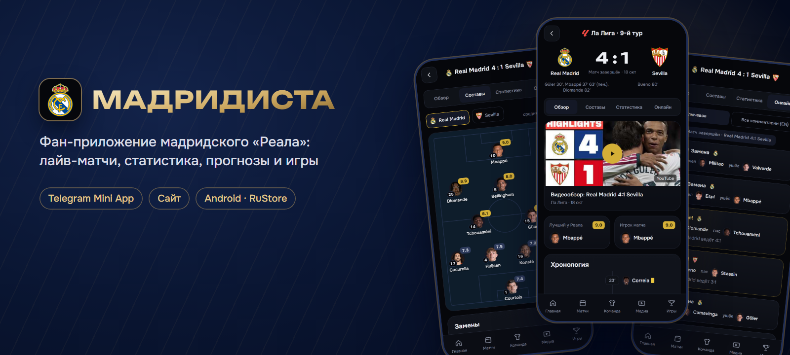

<h3>Всё о «Реале» — в одном приложении</h3>

<p>
  <a href="https://realmadridfan.ru"></a>
  <a href="https://t.me/Real_Madrid_football_bot"></a>
  
</p>

<p>
  
  
  
  
  
  
  
</p>

<sub>Неофициальное фан-приложение · не связано с Real Madrid C.F.</sub>

</div>

---

## ✨ Что внутри

| | |
|---|---|
| ⏱️ **Ближайший матч** | Отсчёт до стартового свистка, стадион, погода, судья со статистикой |
| 🔴 **Live** | Счёт и минута в реальном времени, хронология, плашка «ГОЛ!» с фото автора и конфетти, «Пропустили» на гол соперника |
| 📊 **Разбор матча** | 37 показателей статистики по таймам, xG, график давления, карта ударов, зоны атак |
| 👕 **Составы** | Расстановка на поле с оценками игроков, замены, кто не сыграет |
| 🗒️ **Онлайн** | Ключевые моменты по-русски и текстовая трансляция |
| 🏆 **Турниры** | Таблицы Ла Лиги и Лиги чемпионов, календарь, матчи тура |
| 🧑‍🤝‍🧑 **Игроки** | Профили, статистика сезона, последние матчи |
| 🎯 **Прогнозы** | Угадай счёт и автора гола, очки, общий рейтинг и лиги с друзьями |
| 📰 **Медиа** | Новости и видео прямо в приложении |
| 🎮 **Игры** | Викторина и «Пенальти» |

## 📱 Как выглядит

<table>
  <tr>
    <td align="center">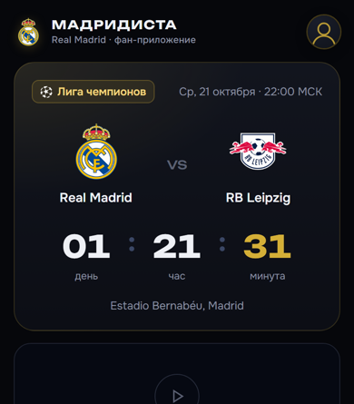<br><sub>Главная</sub></td>
    <td align="center">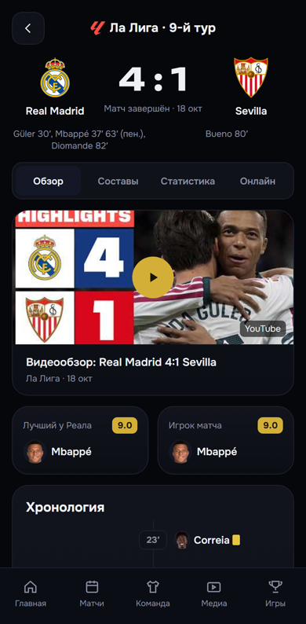<br><sub>Матч</sub></td>
    <td align="center">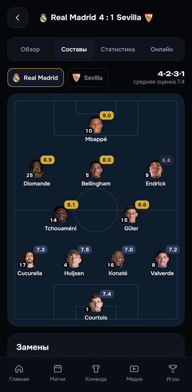<br><sub>Составы</sub></td>
    <td align="center">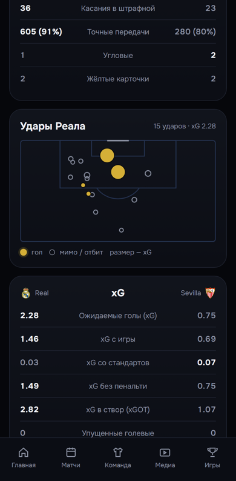<br><sub>Статистика</sub></td>
  </tr>
  <tr>
    <td align="center">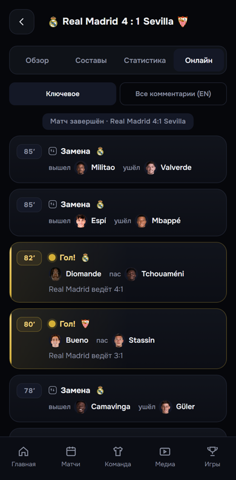<br><sub>Онлайн</sub></td>
    <td align="center">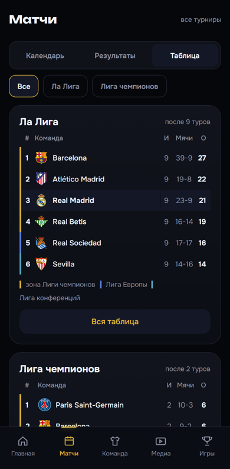<br><sub>Таблица</sub></td>
    <td align="center">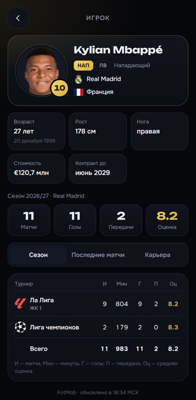<br><sub>Игрок</sub></td>
    <td align="center">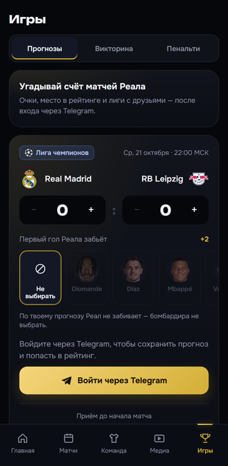<br><sub>Прогнозы</sub></td>
  </tr>
  <tr>
    <td align="center">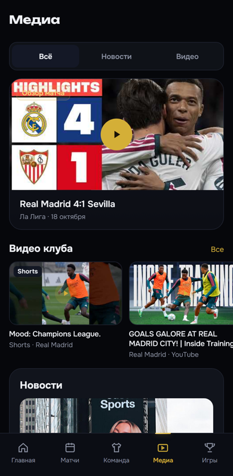<br><sub>Медиа</sub></td>
    <td align="center">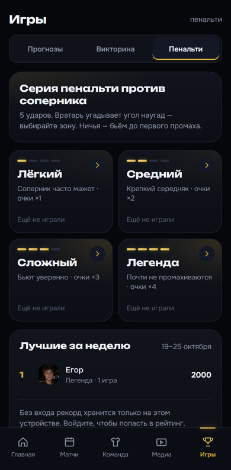<br><sub>Игры</sub></td>
    <td colspan="2" align="center">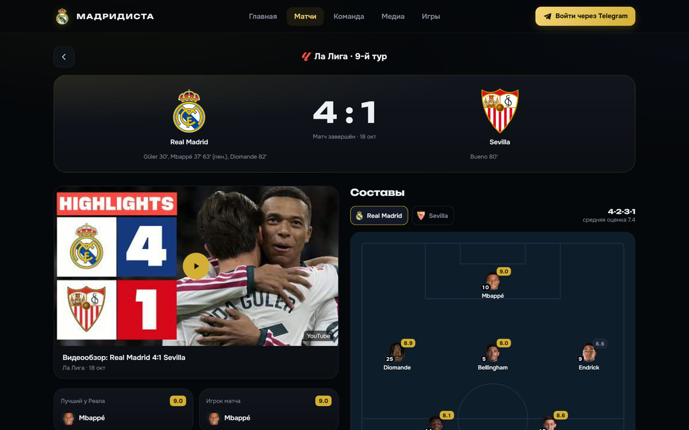<br><sub>Сайт на компьютере</sub></td>
  </tr>
</table>

## 🏗️ Как устроено

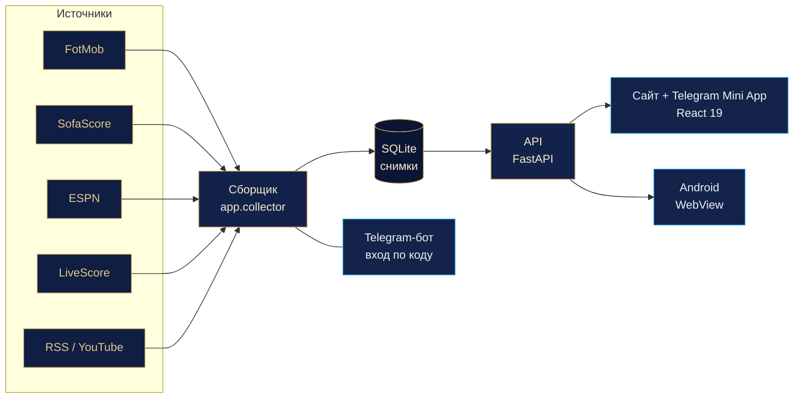

- **Сборщик** опрашивает источники по расписанию: во время матча каждые 12 секунд, вне окна матча — реже. Для каждого вида данных — цепочка резервов **FotMob → SofaScore → ESPN → LiveScore**: упал один источник — данные берутся из следующего, а если упали все, API отдаёт последний удачный снимок с его возрастом.
- **API никогда не ходит во внешние источники** — только читает снимки из SQLite. Поэтому сайт отвечает быстро и не зависит от чужих сбоев.
- **Картинки** (эмблемы, фото игроков, логотипы турниров) идут через кэширующий прокси nginx с нашего домена — клиент не обращается к сторонним сайтам.
- **Прогнозы** — отдельная база: прогнозы, начисление очков после свистка, рейтинги по сезону и месяцу, лиги с приглашением по ссылке.
- **Вход** — Telegram Mini App (initData), на сайте — по одноразовому коду через бота.

## 🧰 Стек

| Часть | Технологии |
|---|---|
| Фронтенд | React 19, TypeScript, Vite, собственный UI-кит, Web Animations API |
| Бэкенд | Python, FastAPI, httpx, SQLite |
| Инфраструктура | Docker Compose (api + collector), nginx с кэшем картинок, автоматический деплой с проверкой `nginx -t` и откатом |
| Android | Kotlin, WebView-оболочка для RuStore |
| Качество | pytest (бэкенд), node:test (фронтенд), Playwright для визуальных проверок |

## 📂 Структура

```
backend/     API и сборщик данных (FastAPI, SQLite), тесты — backend/tests
frontend/    сайт и Telegram Mini App (React 19 + TypeScript + Vite), тесты — frontend/tests
android/     приложение для RuStore (Kotlin, WebView)
deploy/      деплой, nginx, бэкапы, watchdog
design/      макеты и дизайн-система
docs/        документация и картинки README
checks/      скриншоты визуальных проверок
```

## 🚀 Запуск локально

```bash
# бэкенд
cd backend
python -m venv .venv && .venv/Scripts/pip install -r requirements.txt -r requirements-dev.txt
.venv/Scripts/python -m app.collector once team      # один цикл сбора данных команды
.venv/Scripts/uvicorn app.main:app --reload --port 8010
.venv/Scripts/python -m pytest -q                    # тесты

# фронтенд
cd frontend
npm install
npm run dev                                          # http://localhost:5173
npm test && npx tsc -b && npm run build              # тесты, типы, сборка
```

Боевой запуск — `docker compose up -d --build` (контейнеры `api` и `collector`), деплой — `bash deploy/deploy.sh`.
Секреты (`BOT_TOKEN` и др.) — только в `.env` на сервере, в репозиторий не попадают.

## 📜 Дисклеймер

«Мадридиста» — неофициальное фан-приложение, сделанное болельщиками. Проект не связан с Real Madrid C.F.,
LaLiga, UEFA и их партнёрами. Названия клубов, эмблемы и фотографии принадлежат их правообладателям и
используются для информирования. Данные о матчах — из открытых источников.

<div align="center"><sub>Сделано с ❤️ к «Реалу» · <a href="https://realmadridfan.ru">realmadridfan.ru</a></sub></div>
